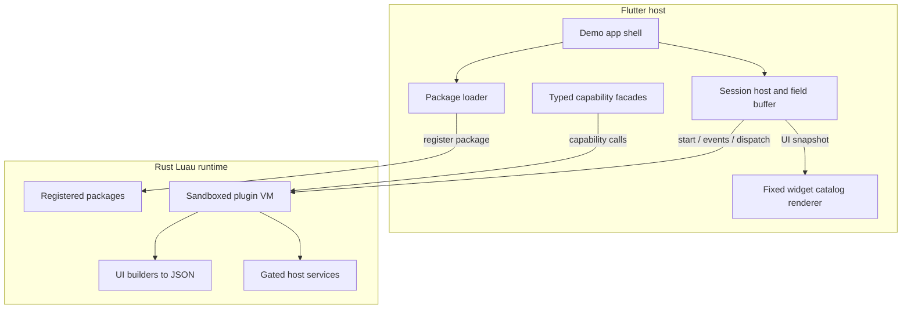

# Architecture

This project is a proof of concept for **runtime Luau plugins** inside a Flutter app. Plugins draw UI from a fixed widget catalog, talk to the host through gated services, and can expose typed capabilities back to the app. Lua never runs in Dart: each plugin gets a sandboxed Luau VM in Rust, reached over flutter_rust_bridge.

## Layers

**Flutter** owns presentation, package discovery from assets, session orchestration, and local buffering of form values. It turns JSON UI snapshots into real widgets and routes user actions back as data.

**Rust** owns the plugin registry, one long-lived sandboxed VM per active session, the Lua-facing UI builders, and privileged host services (network, storage, crypto, logging). Permissions declared on the package gate those services.

**The bridge** carries commands and results. It does not ferry live Flutter objects or Lua function references. UI crosses the boundary as a JSON snapshot; events and capability calls cross as structured data.

## Why a fixed catalog and JSON UI

Plugins must not invent arbitrary Flutter trees. The host publishes a closed set of UI building blocks. Codegen keeps the Lua constructors, the snapshot shape, and the Dart deserializers aligned.

That design keeps the trust boundary clear: the plugin describes *what* to show within an approved vocabulary; the host decides *how* it looks and what an interaction means. Interactive controls do not register live Lua callbacks across FFI. A button carries an event payload; a press delivers that payload into the session. Text fields and similar controls keep values on the Flutter side until an action flushes them into the plugin.

## Session lifecycle

A package is registered from assets (manifest, entry script, optional modules). Starting a plugin creates a fresh sandboxed VM, injects UI builders, a restricted module loader, and the permitted host surface, then loads the script.

The host then drives a loop roughly like this:

1. Optionally flush buffered form fields into the plugin.
2. Deliver an event (bootstrap, UI action, or host-result follow-up).
3. Let the plugin return host intents; execute them in rounds until the queue settles or a round limit is hit.
4. Ask the plugin for a new UI snapshot and rebuild the Flutter tree.

Capability calls follow a parallel path: the app invokes a named method with arguments, the plugin answers without necessarily producing UI, and typed Dart facades can wrap that contract for a cleaner app API.

Stopping and disposing are intentionally asymmetric in the demo host: tearing down the Flutter controller does not always stop the Rust session immediately, which avoids races during hot refresh. Sessions are still replaced when the same plugin id is started again.

## Trust model

Each VM runs with Luau sandboxing enabled. Packages declare what they need: host service categories, which HTTP hosts they may contact, and which vendored modules they may `require`. Enforcement lives in Rust. There is not yet a product-facing permission grant UI; the demo trusts the manifests you ship.

Network access is allowlisted per package. Storage offered to plugins is a simple per-plugin key-value surface (in memory for this PoC). Crypto helpers are generic primitives; provider-specific protocols (for example Proton SRP) live in plugin Luau, not as special host APIs.

## Product shape and limits

The Flutter app is a demo shell that registers a few packages and hosts one plugin view at a time. It is not packaged as a reusable library yet.

Architectural consequences of the current PoC:

- Plugin storage is ephemeral across process restarts.
- Session ownership between Flutter dispose and Rust stop is soft; treat long-lived background VMs as an open lifecycle question.
- Plugins can request host work both synchronously from Lua and via intent queues; both exist for historical and ergonomic reasons.
- The UI vocabulary is intentionally small. Layout and theming beyond the catalog are out of scope until the catalog grows through the codegen path.

For how authors and maintainers work with this design, see the [plugin guide](PLUGIN_GUIDE.md) and [framework development](DEVELOPING.md) notes.
