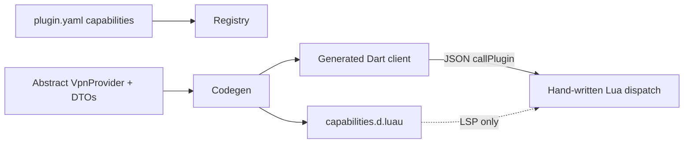

# Capability contracts

Capabilities are **named headless APIs** a plugin advertises so the Flutter app can call into Luau without going through the UI tree.

## Flow

1. **Advertise** in `plugin.yaml`: `capabilities: [vpn.provider]`
2. **Define** an abstract Dart API + DTOs in the app (source of truth)
3. **Codegen** emits the typed client (`callPlugin` + top-level serde) and Luau stubs
4. **Implement** Lua `dispatch(method, args)` by hand in each plugin package



JSON still crosses the bridge. Type safety is enforced when Dart decodes into DTOs (`CapabilityDecodeException` on mismatch). Rust/Lua do not validate DTO shapes at runtime.

## Flutter authoring

```dart
@LuaCapability('vpn.provider')
abstract class VpnProvider {
  factory VpnProvider(String pluginId) = _VpnProviderImpl;
  String get pluginId;
  bool get isCapable;
  Future<VpnStatus> getStatus();
  Future<VpnConfigResult> getSelectedConfig();
}

@LuaCapabilityDto()
class VpnStatus {
  final bool ok;
  final String? screen;

  const VpnStatus({required this.ok, this.screen});
  // no fromJson / toJson — generated top-level in *.g.dart
}
```

DTO rules:

- Declare **fields + generative constructor** only.
- Codegen writes `_$VpnStatusFromJson` / `_$VpnStatusToJson` in the part file; the client calls those (Lua → Dart results and Dart → Lua args).
- Omit empty args types; use no-arg methods when the plugin needs no input object.

Run (Dart parts — standard Flutter codegen):

```bash
cd example && dart run build_runner build
```

Full refresh (widgets + Rust/Luau + capability Luau stubs + build_runner):

```bash
./tool/generate.sh
```

Luau capability stubs alone (outside `lib/`, not via build_runner):

```bash
cd tool/codegen && dart run bin/lua_plugin_codegen.dart \
  --generate-capabilities \
  --input ../../example/lib \
  --luau-out ../../example/assets/plugins/_types
```

Outputs:

- `example/lib/vpn_provider.g.dart` — client + top-level `_$DtoFromJson` / `_$DtoToJson` (**build_runner**)
- `example/assets/plugins/_types/capabilities.d.luau` — method/DTO stubs for luau-lsp (CLI)

## Lua authoring

Stubs describe expected tables; **do not** treat them as a runnable `dispatch`. Each plugin implements its own logic (see fake vs Proton VPN). Method names default to snake_case of the Dart method (`getStatus` → `get_status`); override with `@LuaCapabilityMethod('…')`.

## Vs HostAPIs / UI catalog

| Surface | Owned by | Purpose |
|---------|----------|---------|
| HostAPIs (`host.*`) | App Rust `setup` | Privileged ops plugins call |
| UI catalog (`ui.*`) | App / `@LuaWidget` | Snapshot widgets |
| Capabilities | App Dart contract + plugin `dispatch` | App calls plugin headlessly |
