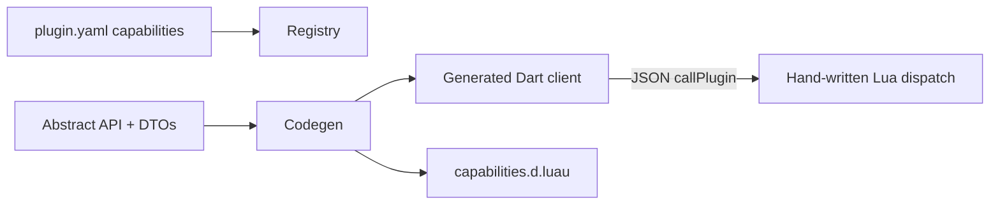

# Capabilities

Capabilities are **named headless APIs** a plugin advertises so the Flutter app
can call into Luau without going through the UI tree.

## Flow

1. **Advertise** in `plugin.yaml` (`capabilities: […]`).
2. **Define** an abstract Dart API + DTOs in the app (source of truth).
3. **Codegen** emits the typed client and Luau stubs.
4. **Implement** Lua `dispatch(method, args)` by hand in each plugin.



JSON still crosses the bridge. Type safety is enforced when Dart decodes into
DTOs (`CapabilityDecodeException` on mismatch).

## When to use

Use a capability when multiple UI flows share the same contract, or when the app
must act while the plugin view is not focused. Keep session state coherent
between UI events and capability calls (shared plugin storage is the usual glue).

Leave field-by-field DTO and annotation details in the example
(`example/lib/vpn_provider.dart`) and generated parts — do not inventory them
here.

## Regenerate

```bash
dart run fluau_codegen --capabilities --input lib --luau-out assets/plugins/_types
# or full refresh: ./tool/generate.sh
```

See [codegen/WHEN_TO_RUN.md](../codegen/WHEN_TO_RUN.md).
