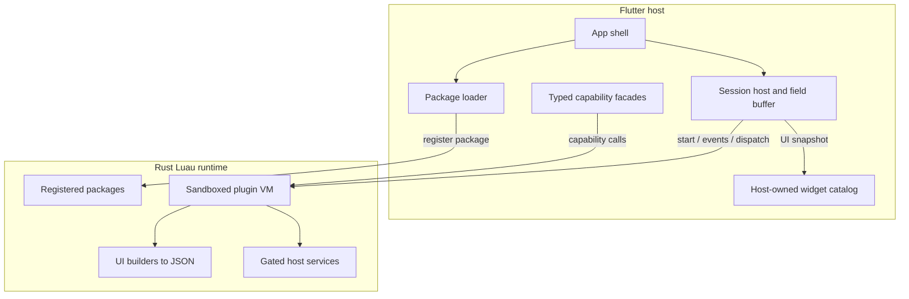

# Architecture

fluau hosts **runtime Luau plugins** inside a Flutter app. Plugins draw UI from a
host-owned widget catalog, talk to the host through gated services, and can
expose typed capabilities back to the app. Lua never runs in Dart: each plugin
gets a sandboxed Luau VM in Rust, reached over a Flutter–Rust bridge
([flutter_rust_bridge](https://cjycode.com/flutter_rust_bridge/) in the example).

## Layers

**Flutter** owns presentation, package discovery from assets, session
orchestration, permission persistence, and the UI catalog. It turns JSON UI snapshots
into real widgets and routes user actions back as data.

**Rust** owns the plugin registry, one sandboxed VM per active session, the
Lua-facing UI builders registered by the app, and privileged host services.
Permissions declared on the package gate those services.

**The bridge** carries commands and results. It does not ferry live Flutter
objects or Lua function references. UI crosses as a JSON snapshot; events and
capability calls cross as structured data.

## Why a host-owned catalog and JSON UI

Plugins must not invent arbitrary Flutter trees. The host publishes a closed set
of UI building blocks. Codegen keeps the Lua constructors, the snapshot shape,
and the Dart deserializers aligned.

That design keeps the trust boundary clear: the plugin describes *what* to show
within an approved vocabulary; the host decides *how* it looks and what an
interaction means. Interactive controls do not register live Lua callbacks
across FFI. A button carries an event payload (or a Lua function that the session
turns into a reserved `action` payload); a press delivers that payload into
the session. Text fields keep values on the Flutter side until an action flushes
them into the plugin.

The fluau Dart package ships annotations and host helpers only — **no**
default widgets. See [UI catalog](../host/UI_CATALOG.md).

## Session lifecycle

A package is registered from assets (manifest, entry script, optional modules).
Starting a plugin creates a fresh sandboxed VM, injects UI builders, a restricted
module loader, and the permitted host surface, then loads the script.

The host then drives a loop roughly like this:

1. Optionally flush buffered form fields into the plugin.
2. Deliver an event (bootstrap, UI action, or host-result follow-up).
3. Let the plugin return host intents; execute them in rounds until the queue
   settles or a round limit is hit.
4. Ask the plugin for a new UI snapshot and rebuild the Flutter tree.

Capability calls follow a parallel path: the app invokes a named method with
arguments; the plugin answers without necessarily producing UI.

Stopping and disposing can be asymmetric in a demo host (Flutter dispose may not
immediately stop the Rust session) to avoid races during hot refresh. Sessions
are still replaced when the same plugin id is started again.

## Trust model

Each VM runs with Luau sandboxing enabled. Packages declare host APIs (required
or optional) and constraints in `plugin.yaml`.

**Request vs grant:** the manifest is the request. The Flutter host persists user
permission decisions via `PluginGrantStore` and passes an effective snapshot into
session start. See [Plugin permissions](../host/PLUGIN_PERMISSIONS.md).

**Enforcement:** a central Rust `PermissionGate` is the security boundary for
privileged host work. Injecting only granted host modules is ergonomics; every
use re-checks the gate.

**`require`:** a custom loader resolves only modules registered with the package.
There is no filesystem/`package.path` require and no third-party package manager
in the sandbox.

## 0.1 notes

- Bridge-from-zero is out of scope here — use FRB’s docs.
- Soft session dispose vs Rust stop remains a host lifecycle choice.
- Storage and HostAPIs are app-defined; the example uses in-memory plugin KV and
  demo host modules.
